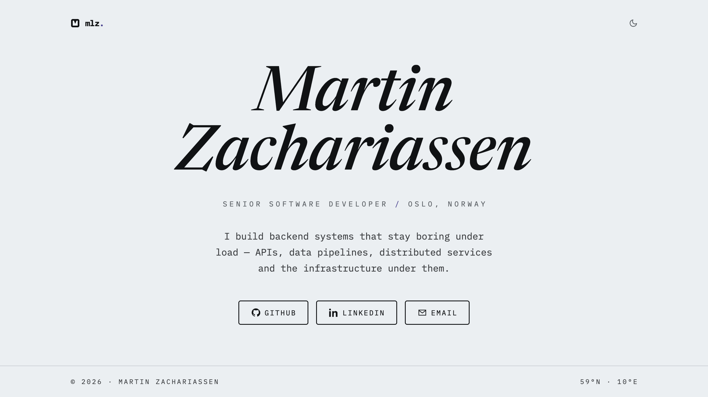

<p align="center">
  <a href="https://mlz.no">
    <picture>
      <source media="(prefers-color-scheme: dark)" srcset=".github/assets/banner-dark.png" />
      
    </picture>
  </a>
</p>

<p align="center">
  <a href="https://github.com/martinzachariassen/mlz-no/actions/workflows/ci.yml"></a>
  <a href="LICENSE"></a>
</p>

<p align="center">
  <a href="https://mlz.no"><b>Live site</b></a>
  &nbsp;·&nbsp;
  <a href="#development"><b>Development</b></a>
  &nbsp;·&nbsp;
  <a href="public/brand/BRAND.md"><b>Brand</b></a>
  &nbsp;·&nbsp;
  <a href="#cicd"><b>Deploys</b></a>
</p>

Martin Zachariassen's personal homepage, live at [mlz.no](https://mlz.no).

It is a single static page with no build step: `public/` is served exactly as
committed, by Firebase Hosting. Because nothing runs per request, all
hardening (CSP, HSTS, cache-control) is declared in
[`firebase.json`](firebase.json) rather than in code, and a script proves it
takes effect.

## What's in it

| | |
| --- | --- |
| **No build step** | Plain HTML, CSS and scripts. What is in `public/` is what is served. |
| **Light and dark themes** | Follows the system setting, with a toggle that remembers your choice. The saved theme is applied before first paint, so there is no flash. |
| **A design system** | Colours, fonts and the logo come from tokens in [`public/brand/`](public/brand/BRAND.md), published under `/brand/` for other sites to reuse. |
| **Verified headers** | [`scripts/verify.sh`](scripts/verify.sh) boots the Hosting emulator and checks that the security headers, cache policy, `/brand/` CORS and custom 404 actually work. |
| **Keyless deploys** | Every PR gets a preview, every push to `main` goes to production, and GitHub logs in to Google Cloud with Workload Identity Federation. |
| **Infrastructure as code** | The GCP project, Hosting, the custom domain and the repo settings are Terraform in [`infra/`](infra/README.md). |

## Architecture

```
Browser ──► Firebase Hosting ──► static files from public/
                 │
                 └─ headers, cache policy, redirects, 404 ◄── firebase.json
```

- `public/index.html` is the page. Its styles are split by section in
  `public/css/` (base, topbar, hero, buttons, footer, motion).
- Three small scripts in `public/js/` add the colour-theme toggle, the glitch
  effect (occasional character flicker, off for reduced-motion) and the year
  in the footer. `public/theme-init.js` runs first and applies the saved theme
  before first paint.
- `index.html` links `public/brand/tokens.css` directly, so the site uses the
  same tokens it publishes.
- There is no server and no client-side router. Every page is a real `.html`
  file at a fixed path, and `public/404.html` is served as an actual 404 for
  anything else.

## Development

Requires [Bun](https://bun.sh). It is pinned in [`mise.toml`](mise.toml)
alongside Terraform (for `infra/`), so `mise install` sets both up. The Firebase CLI is a devDependency and needs no
separate install.

```sh
bun install

bun run dev           # Hosting emulator: http://127.0.0.1:5050
bun run lint          # biome ci .
bun run format        # biome check --write .
./scripts/verify.sh   # boots the emulator, asserts headers, cache, CORS and 404
```

The emulator uses port 5050 because macOS holds 5000 for AirPlay.
`bun install` also wires up a pre-commit hook that runs `bun run lint`.

`firebase.json` is the only place the response headers can live, and its
`headers` list is last-match-wins, so reordering it can silently break a rule.
Run `./scripts/verify.sh` after any change to `firebase.json` or
`public/404.html`. It is the quality gate: CI and the deploy job run the same
file.

## Design tokens

`public/brand/tokens.json` is the single source for the site's colours, fonts
and logo. Edit it, then:

```sh
bun run brand        # fill in hex, check contrast, regenerate the rest
bun run brand:png    # re-render the logo PNGs (macOS + Chrome), if fg or the mark changed
```

`tokens.css`, `tailwind.css`, `brand.json`, the logo SVGs and the colour table
in `BRAND.md` are generated and committed — don't edit them by hand. CI runs
`bun run brand:check` to catch drift. The files are served under `/brand/`, so
their URLs are a public contract: don't rename or remove them without a
version bump (`brand-vX.Y.Z`, see [`BRAND.md`](public/brand/BRAND.md)).

<details>
<summary><strong>Social card</strong></summary>

`public/assets/social/og.png` (the 1200×630 Open Graph image) is rendered from
[`tools/og/og.html`](tools/og/og.html) using the site's tokens and fonts (light
theme). Regenerate it whenever those change:

```sh
python3 -m http.server 8765 --bind 127.0.0.1 &   # serve the repo root
"/Applications/Google Chrome.app/Contents/MacOS/Google Chrome" --headless \
  --hide-scrollbars --window-size=1200,630 --force-device-scale-factor=1 \
  --virtual-time-budget=4000 --screenshot=public/assets/social/og.png \
  http://127.0.0.1:8765/tools/og/og.html
kill %1
```

LinkedIn and others cache the card for days. Use LinkedIn's Post Inspector to
make them fetch the new one.

</details>

<details>
<summary><strong>README banner</strong></summary>

The banner at the top of this file is a screenshot of the live page in each
theme, kept in `.github/assets/` so it is not deployed. Retake it after a
visible change to the page:

```sh
python3 -m http.server 8766 --bind 127.0.0.1 --directory public &
for theme in light:1 dark:0; do
  "/Applications/Google Chrome.app/Contents/MacOS/Google Chrome" --headless \
    --hide-scrollbars --window-size=1280,640 --force-device-scale-factor=2 \
    --force-prefers-reduced-motion \
    --blink-settings=preferredColorScheme=${theme#*:} \
    --virtual-time-budget=4000 \
    --screenshot=.github/assets/banner-${theme%:*}.png http://127.0.0.1:8766/
done
kill %1
```

`--force-prefers-reduced-motion` keeps the glitch effect out of the shot.

</details>

## CI/CD

| Workflow | Runs on | Does |
|---|---|---|
| [`ci.yml`](.github/workflows/ci.yml) | PRs and pushes to `main` | Lint, `brand:check`, `verify.sh`, `terraform fmt` and `validate` |
| [`dependency-review.yml`](.github/workflows/dependency-review.yml) | PRs | Blocks dependencies with known vulnerabilities of moderate severity or worse |
| [`preview.yml`](.github/workflows/preview.yml) | PRs | Deploys `public/` to a Hosting preview channel that expires after 7 days |
| [`deploy.yml`](.github/workflows/deploy.yml) | Push to `main`, manual | Runs lint, `brand:check` and `verify.sh`, then deploys to production |
| [`gcp-auth-check.yml`](.github/workflows/gcp-auth-check.yml) | Weekly, manual | Catches a broken Google Cloud login before the next deploy does |

Workflows authenticate to Google Cloud with Workload Identity Federation, so
the repository stores no long-lived credentials. Fork and Dependabot PRs skip
the preview because GitHub gives them no OIDC token.

## Infrastructure

The GCP project, Firebase Hosting, the custom domain, the deploy login and the
GitHub repository settings are Terraform in [`infra/`](infra/README.md),
applied by hand. The site content is not in Terraform; it ships from
`deploy.yml`. CI only checks `fmt` and `validate`.

<details>
<summary><strong>Project layout</strong></summary>

```
public/          The site, served as-is: pages, css/, js/, assets/, brand/
public/brand/    Design tokens, logo and brand guide (a public contract)
scripts/         brand.js, brand-png.js and verify.sh
tools/           Source pages for the logo PNGs and the social card
infra/           Terraform for GCP, Hosting, the domain and the GitHub repo
.github/         Workflows, PR template, Dependabot and the README banner
firebase.json    Hosting config: headers, cache policy, redirects, emulator port
```

</details>

## Contributing

This is a personal site, so I'm not looking for new features, but bug reports
and small fixes are welcome as an issue or a pull request.

- `bun run lint` and `./scripts/verify.sh` must pass.
- Commits must be signed. `main` requires linear history, and PRs are squashed
  or rebased.

## License

[MIT](LICENSE)
