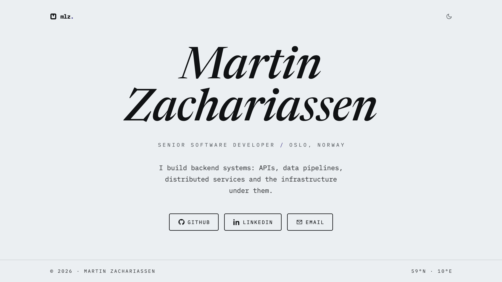

<p align="center">
  <a href="https://mlz.no">
    <picture>
      <source media="(prefers-color-scheme: dark)" srcset=".github/assets/banner-dark.png" />
      
    </picture>
  </a>
</p>

<p align="center">
  <a href="https://github.com/martinzachariassen/mlz-no/actions/workflows/ci.yml"></a>
  <a href="https://github.com/martinzachariassen/mlz-no/releases/latest"></a>
  <a href="LICENSE"></a>
</p>

**The source for [mlz.no](https://mlz.no), Martin Zachariassen's personal
homepage.** One static page, no build step, no server: what is committed in
`public/` is exactly what Firebase Hosting serves.

Because nothing runs per request, all hardening (CSP, HSTS, cache-control)
lives in [`firebase.json`](firebase.json) instead of code, and a script boots
the Hosting emulator to prove it actually takes effect.

## Getting started

**1. Install the tools.** [Bun](https://bun.sh) and Terraform are pinned in
[`mise.toml`](mise.toml), so one command sets up both:

```sh
mise install
```

**2. Install dependencies.** The Firebase CLI is a devDependency, so there is
nothing else to install. This also wires up a pre-commit hook that runs
`bun run lint`.

```sh
bun install
```

**3. Run it.** Start the Hosting emulator and open
[http://127.0.0.1:5050](http://127.0.0.1:5050):

```sh
bun run dev
```

> [!TIP]
> Changed `firebase.json` or `public/404.html`? Run `./scripts/verify.sh`
> before you push. It is the same quality gate CI and the deploy job run.

## What's in it

| | |
| --- | --- |
| **No build step** | Plain HTML, CSS and scripts. What is in `public/` is what is served. |
| **Light and dark themes** | Follows the system setting, with a toggle that remembers your choice. The saved theme is applied before first paint, so there is no flash. |
| **A design system** | Colours, fonts and the logo come from tokens in [`public/brand/`](public/brand/BRAND.md), published under `/brand/` for other sites to reuse. |
| **Verified headers** | [`scripts/verify.sh`](scripts/verify.sh) checks that the security headers, cache policy, `/brand/` CORS and custom 404 work in practice. |
| **Keyless deploys** | Every PR gets a preview, every push to `main` goes to production, and GitHub logs in to Google Cloud with Workload Identity Federation. |
| **Infrastructure as code** | The GCP project, Hosting, the custom domain and the repo settings are Terraform in [`infra/`](infra/README.md). |

## Commands

| Command | Does |
| --- | --- |
| `bun run dev` | Hosting emulator on http://127.0.0.1:5050 |
| `bun run lint` | `biome ci .`, the same check as the pre-commit hook and CI |
| `bun run format` | `biome check --write .` |
| `./scripts/verify.sh` | Boots the emulator and asserts headers, cache policy, CORS and the 404 |
| `bun run brand` | Regenerates everything derived from `public/brand/tokens.json` |
| `bun run brand:check` | Fails if the generated brand files have drifted (run in CI) |
| `bun run brand:png` | Re-renders the logo PNGs (macOS + Chrome) |

## How it works

```
Browser ──► Firebase Hosting ──► static files from public/
                 │
                 └─ headers, cache policy, redirects, 404 ◄── firebase.json
```

- `public/index.html` is the page. Its styles are split by section in
  `public/css/` (base, topbar, hero, buttons, toast, footer, motion).
- Small scripts in `public/js/` add the theme toggle, the glitch effect on the
  wordmark and footer (off for reduced motion), the footer year, and the Email
  button, which copies the address and confirms it in a toast.
  `public/theme-init.js` runs first and applies the saved theme before first
  paint.
- `index.html` links `public/brand/tokens.css` directly, so the site uses the
  same tokens it publishes.
- Every page is a real `.html` file at a fixed path. Anything else gets
  `public/404.html` as an actual 404.

> [!WARNING]
> The `headers` list in `firebase.json` is **last-match-wins**. Reordering it
> can silently drop a rule, which is why `verify.sh` tests the served
> responses rather than the config.

## Design tokens

`public/brand/tokens.json` is the single source for the site's colours, fonts
and logo. Edit it, then run `bun run brand` to fill in hex values, check
contrast and regenerate the rest. If the foreground colour or the mark
changed, also run `bun run brand:png`.

`tokens.css`, `tailwind.css`, `brand.json`, the logo SVGs and the colour table
in `BRAND.md` are generated and committed. Don't edit them by hand; CI runs
`bun run brand:check` to catch drift.

> [!IMPORTANT]
> Everything under `/brand/` is served publicly for other sites to use, so its
> URLs are a contract. Don't rename or remove files there without a version
> bump (`brand-vX.Y.Z`, see [`BRAND.md`](public/brand/BRAND.md)).

<details>
<summary><strong>Regenerate the social card</strong></summary>

`public/assets/social/og.png` (the 1200×630 Open Graph image) is rendered from
[`tools/og/og.html`](tools/og/og.html) using the site's tokens and fonts (light
theme). Regenerate it whenever those change:

```sh
python3 -m http.server 8765 --bind 127.0.0.1 &   # serve the repo root
"/Applications/Google Chrome.app/Contents/MacOS/Google Chrome" --headless \
  --hide-scrollbars --window-size=1200,630 --force-device-scale-factor=1 \
  --virtual-time-budget=4000 --screenshot=public/assets/social/og.png \
  http://127.0.0.1:8765/tools/og/og.html
kill %1
```

</details>

<details>
<summary><strong>Retake the README banner</strong></summary>

The banner at the top of this file is a screenshot of the live page in each
theme, kept in `.github/assets/` so it is not deployed. Retake it after a
visible change to the page:

```sh
python3 -m http.server 8766 --bind 127.0.0.1 --directory public &
for theme in light:1 dark:0; do
  "/Applications/Google Chrome.app/Contents/MacOS/Google Chrome" --headless \
    --hide-scrollbars --window-size=1280,720 --force-device-scale-factor=2 \
    --force-prefers-reduced-motion \
    --blink-settings=preferredColorScheme=${theme#*:} \
    --virtual-time-budget=4000 \
    --screenshot=.github/assets/banner-${theme%:*}.png http://127.0.0.1:8766/
done
kill %1
```

`--force-prefers-reduced-motion` keeps the glitch effect out of the shot.

</details>

## Deploys

Pushes to `main` deploy to production automatically. Workflows log in to
Google Cloud with Workload Identity Federation, so the repository stores no
long-lived credentials.

| Workflow | Runs on | Does |
| --- | --- | --- |
| [`ci.yml`](.github/workflows/ci.yml) | PRs and pushes to `main` | Lint, `brand:check`, `verify.sh`, `terraform fmt` and `validate` |
| [`dependency-review.yml`](.github/workflows/dependency-review.yml) | PRs | Blocks dependencies with known vulnerabilities of moderate severity or worse |
| [`preview.yml`](.github/workflows/preview.yml) | PRs | Deploys `public/` to a Hosting preview channel that expires after 7 days |
| [`deploy.yml`](.github/workflows/deploy.yml) | Push to `main`, manual | Runs lint, `brand:check` and `verify.sh`, then deploys to production |
| [`gcp-auth-check.yml`](.github/workflows/gcp-auth-check.yml) | Weekly, manual | Catches a broken Google Cloud login before the next deploy does |

The GCP project, Firebase Hosting, the custom domain, the deploy login and the
GitHub repository settings are Terraform in [`infra/`](infra/README.md),
applied by hand. The site content itself ships from `deploy.yml`; CI only runs
`terraform fmt` and `validate`.

<details>
<summary><strong>Project layout</strong></summary>

```
public/          The site, served as-is: pages, css/, js/, assets/, brand/
public/brand/    Design tokens, logo and brand guide (a public contract)
scripts/         brand.js, brand-png.js and verify.sh
tools/           Source pages for the logo PNGs and the social card
infra/           Terraform for GCP, Hosting, the domain and the GitHub repo
.github/         Workflows, PR template, Dependabot and the README banner
firebase.json    Hosting config: headers, cache policy, redirects, emulator port
```

</details>

## Troubleshooting

| Problem | Fix |
| --- | --- |
| The emulator won't start on port 5000 | It isn't meant to: macOS holds 5000 for AirPlay, so the emulator uses 5050. |
| `verify.sh` fails after editing `firebase.json` | Check the order of the `headers` list. It is last-match-wins, so a later, broader rule can override an earlier one. |
| `brand:check` fails in CI | A generated brand file was edited by hand or not regenerated. Run `bun run brand` and commit the result. |
| A PR has no preview link | Fork and Dependabot PRs skip the preview, because GitHub gives them no OIDC token. |
| LinkedIn shows an old social card | LinkedIn and others cache the card for days. Use LinkedIn's Post Inspector to make it fetch the new one. |

## Contributing

This is a personal site, so I'm not looking for new features, but bug reports
and small fixes are welcome as an
[issue](https://github.com/martinzachariassen/mlz-no/issues/new) or a pull
request. `bun run lint` and `./scripts/verify.sh` must pass, commits must be
signed, and `main` requires linear history (PRs are squashed or rebased).
Changes are listed in the [changelog](CHANGELOG.md).

Licensed under [MIT](LICENSE).
